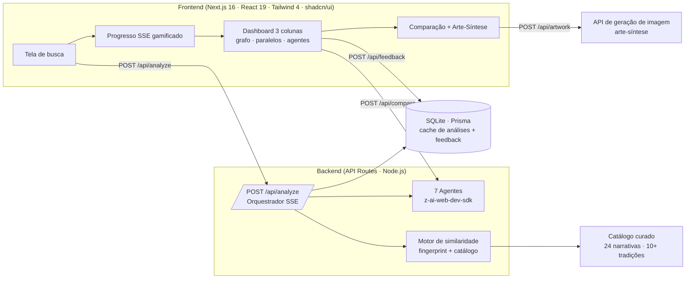

<div align="center">


# 🔮 Oráculo das Conexões Narrativas

### IA e a Ciência das Histórias — Hermenêutica Digital


**Uma estação de trabalho analítica que utiliza LLMs para dissecar o monomito e a estrutura narrativa, transformando arquétipos abstratos em dados visuais e insights acionáveis para criadores.**

[Funcionalidades](#-funcionalidades) · [Como funciona](#-como-funciona) · [Arquitetura](#-arquitetura) · [Rodar localmente](#-rodando-localmente) · [Roadmap](#-roadmap) · [Ética](#-ética--limitações)

</div>

---

## 📖 Sobre o projeto

Por que histórias de **culturas separadas por milênios** ressoam de forma tão parecida?

O **Oráculo** recebe qualquer narrativa — um mito, um filme, um livro, um personagem ("Perseu", "Matrix", "Fausto") — e orquestra **7 agentes especialistas de IA** baseados em frameworks teóricos reais (**Campbell, Vogler, Jung, von Franz, Freud, Chevalier & Cirlot, Propp, Lévi-Strauss**) para:

1. **Decompor** a obra em estrutura, arquétipos, símbolos e temas;
2. **Calcular um "fingerprint" narrativo** e traçar **paralelos com um catálogo curado** de mitologias e cultura pop;
3. **Visualizar** tudo num grafo interativo, com **scores transparentes** e **comparações profundas** lado a lado.

> 🎯 **Público-alvo:** roteiristas, acadêmicos de Letras/Cinema, game designers e entusiastas de *lore* que buscam profundidade analítica além do superficial.

---

## ✨ Funcionalidades

| | |
|---|---|
| 🕵️ **Análise Multi-Lente** | 7 agentes virtuais executados em paralelo via SSE com progresso gamificado em tempo real |
| 🕸️ **Grafo Interativo** | Force-directed graph em SVG puro (sem libs): arraste nós, pan/zoom, hover com preview, clique para comparar, **exportação PNG** |
| 🧮 **Score Transparente** | Similaridade calculada com fingerprints ponderados — cada conexão mostra o *breakdown* por critério (motivos 35%, arquétipos 25%, temas 25%, estrutura 15%) |
| ⚡ **Comparação Profunda** | Modal lado a lado com convergências agrupadas por categoria, diferenças, símbolos compartilhados e narrativa explicativa |
| 🎨 **Arte-Síntese** | Geração de arte conceitual via IA para representar a essência de cada conexão |
| 🧭 **Explorar Catálogo** | 24 narrativas curadas de 10+ tradições (Grega, Nórdica, Egípcia, Mesopotâmica, Hindu, Yorubá/Ashanti, Asteca, Japonesa, Celta + cultura pop) com busca por motivo/arquétipo |
| 📚 **Documentação Integrada** | Aba com o estudo de caso completo: arquitetura, inovações, roadmap e ética |
| 💾 **Cache Inteligente** | Análises persistidas em SQLite (Prisma) — repetir uma análise é instantâneo |
| 📤 **Export & Feedback** | Export JSON da análise completa, copiar JSON, feedback útil/não-útil (human-in-the-loop) |
| 📱 **Responsivo** | Mobile-first com dashboard de 3 colunas no desktop |

---

## 🤖 Como funciona

```
INPUT (usuário)
   ↓
VALIDAÇÃO & CACHE (SQLite via Prisma)
   ↓
ANÁLISE MULTI-AGENTE (paralela, streaming SSE)
   ↓
FINGERPRINT NARRATIVO
   ↓
RETRIEVAL no catálogo curado (grounding anti-alucinação)
   ↓
ENRIQUECIMENTO LLM + SCORE HÍBRIDO
   ↓
VISUALIZAÇÃO INTERATIVA
```

### Os 7 agentes especialistas

| Agente | Lente teórica | Entrega |
|---|---|---|
| 🪪 **Identificador** | Busca factual | Nome, tipo, origem cultural, período, personagens, sinopse (ou variantes do título se não reconhecida) |
| 🏛️ **Estruturalista** | Campbell / Vogler | Atos, beats, clímax, resolução + os **12 estágios da Jornada do Herói** com evidências |
| 🎭 **Arquetípico** | Jung / von Franz | Personagens classificados (Herói, Sombra, Mentor, Trickster, Anima/Animus...) + processo de individuação |
| 🔣 **Simbólico** | Chevalier / Cirlot | Símbolos e motivos com intensidade, significado cultural vs. universal e comparáveis históricos |
| 💭 **Filosófico-Temático** | Filosofia clássica e contemporânea | Temas universais, questões existenciais e dilemas éticos |
| 🧠 **Psicanalítico** | Freud / Jung / Lacan | Complexos, desejos inconscientes, leituras freudiana e junguiana — **com disclaimer de especulação** |
| 🌍 **Comparativo Mitológico** | Mitologia comparada (Frazer, Raglan, Propp) | Top paralelos com convergências, diferenças, categorias e justificativa |

### Motor de similaridade híbrido (o diferencial anti-alucinação)

1. Cada análise gera um **fingerprint narrativo** (motivos, arquétipos, temas, beats);
2. Um **score determinístico** compara o fingerprint com o catálogo curado — matching semântico leve por tokens (`"fogo"` ≈ `"fogo do conhecimento"` → crédito parcial), normalizado por dimensões ativas;
3. O LLM **só enriquece candidatos que já existem no catálogo** (grounding) — nunca inventa paralelos — podendo ajustar o score em ±8;
4. O resultado é **explicável**: cada conexão exibe convergências, diferenças e o breakdown do score.

---

## 🏗️ Arquitetura



### Estrutura do projeto

```
src/
├── app/
│   ├── page.tsx                  # Página única (busca → progresso → dashboard)
│   └── api/
│       ├── analyze/              # POST — orquestrador SSE multi-agente
│       ├── analysis/[id]/        # GET — análise cacheada
│       ├── analyses/             # GET — histórico recente
│       ├── catalog/              # GET — catálogo curado com busca
│       ├── compare/              # POST — comparação profunda (LLM)
│       ├── artwork/              # POST — arte-síntese (imagem IA)
│       └── feedback/             # POST — human-in-the-loop
├── components/oracle/            # UI: SearchScreen, ProgressScreen, Dashboard,
│                                 #     NarrativeGraph (SVG próprio), ParallelsList,
│                                 #     AgentPanels, ComparisonModal, ExploreTab, DocsTab...
└── lib/
    ├── oracle-types.ts           # Contrato compartilhado front/back
    ├── oracle-agents.ts          # Prompts + orquestração dos 7 agentes
    ├── similarity.ts             # Fingerprint, matching semântico, scoring
    ├── oracle-catalog.ts         # 24 narrativas curadas
    ├── oracle-store.ts           # Estado global (zustand)
    └── oracle-client.ts          # Clientes de API + parser SSE
```

---

## 🚀 Rodando localmente

**Pré-requisitos:** Node.js 20+ (ou Bun 1.x)

```bash
# 1. Clone o repositório
git clone https://github.com/SEU-USUARIO/oraculo-conexoes-narrativas.git
cd oraculo-conexoes-narrativas

# 2. Instale as dependências
bun install   # ou: npm install

# 3. Configure as variáveis de ambiente
cp .env.example .env
# → aponte DATABASE_URL para o seu SQLite, ex.: file:../db/custom.db (relativo a prisma/schema.prisma)

# 4. Crie o banco de dados
bun run db:push   # ou: npx prisma db push

# 5. Inicie o servidor de desenvolvimento
bun run dev       # ou: npm run dev

# 6. Abra http://localhost:3000 e analise "Perseu" ✨
```

> **Nota sobre IA:** este projeto usa o SDK `z-ai-web-dev-sdk` no backend (LLM + geração de imagens). As chamadas de análise funcionam com qualquer backend compatível — adapte `src/lib/oracle-agents.ts` ao seu provider de preferência (OpenAI, Gemini, Anthropic...).

---

## 🗺️ Roadmap

- [x] **MVP** — 7 agentes, catálogo curado, grafo interativo, scores transparentes, cache, feedback
- [ ] **Curto prazo** — export PDF, comparação livre entre quaisquer duas narrativas, ajuste de pesos pelo usuário
- [ ] **Médio prazo** — ingestão semi-automática de catálogo, contas de usuário, coleções temáticas ("Tricksters através das culturas", "Descidas ao submundo")
- [ ] **Longo prazo** — análise multimodal (arte, música, trailers), API pública, modo inverso ("de que mito vem este filme?"), timeline interativa de arquétipos

---

## 🔐 Ética & Limitações

- ⚠️ **Interpretações, não verdades** — toda análise é heurística e gerada por IA; disclaimers aparecem na interface e nos componentes psicanalíticos (marcados como especulação).
- 🌍 **Viés cultural** — LLMs têm viés ocidental/anglófono; o catálogo prioriza diversidade (10+ tradições) e a proveniência dos paralelos é sempre visível (catálogo curado vs. LLM).
- 🔍 **Explicabilidade** — scores mostram o breakdown por critério; paralelos são *grounded* no catálogo para reduzir alucinação.
- 🚫 **Não substitui estudo acadêmico** — a ferramenta encoraja pesquisa aprofundada nas fontes originais.

---

## 📄 Licença

Distribuído sob a licença MIT. Veja [LICENSE](LICENSE).

<div align="center">

*"A conexão entre Prometeu e os heróis modernos não é óbvia até que alguém aponte — e quando aponta, é reveladora. Esse é o valor do Oráculo: **tornar o invisível visível**."*

</div>
