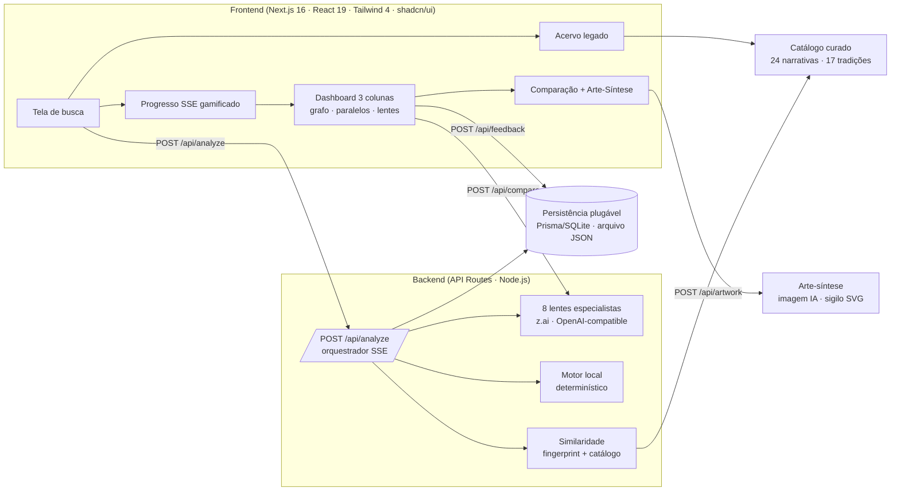

<div align="center">


# 🔮 Oráculo das Conexões Narrativas

### IA e a Ciência das Histórias — Hermenêutica Digital


**Uma estação de trabalho analítica que utiliza LLMs para dissecar o monomito e a estrutura narrativa, transformando arquétipos abstratos em dados visuais e insights acionáveis para criadores.**

**🌐 Ao vivo:** [lucasrangel89.github.io/oraculo](https://lucasrangel89.github.io/oraculo/) · **Edição estática** — o motor roda no seu navegador, sem servidor e sem chave de API.

[Funcionalidades](#-funcionalidades) · [Como funciona](#-como-funciona) · [Dois motores](#-dois-motores-llm-e-local) · [Acervo](#-acervo-legado) · [Arquitetura](#-arquitetura) · [Rodar localmente](#-rodando-localmente) · [GitHub Pages](#-publicação-no-github-pages) · [Roadmap](#-roadmap) · [Ética](#-ética--limitações)

</div>

---

## 📖 Sobre o projeto

Por que histórias de **culturas separadas por milênios** ressoam de forma tão parecida?

O **Oráculo** recebe qualquer narrativa — um mito, um filme, um livro, um personagem ("Perseu", "Matrix", "Fausto") — e orquestra **8 lentes especialistas de IA** baseadas em frameworks teóricos reais (**Campbell, Vogler, Jung, von Franz, Freud, Chevalier & Cirlot, Propp, Lévi-Strauss**) para:

1. **Decompor** a obra em estrutura, arquétipos, símbolos, temas, psique e **contexto cultural-histórico**;
2. **Calcular um "fingerprint" narrativo** e traçar **paralelos com um catálogo curado** de mitologias e cultura pop;
3. **Visualizar** tudo num grafo interativo, com **scores transparentes e ajustáveis** e **comparações profundas** lado a lado.

> 🎯 **Público-alvo:** roteiristas, acadêmicos de Letras/Cinema, game designers e entusiastas de *lore* que buscam profundidade analítica além do superficial.

---

## ✨ Funcionalidades

| | |
|---|---|
| 🕵️ **Análise Multi-Lente** | **8 lentes** em paralelo via SSE, com progresso gamificado em tempo real |
| 🏛️ **Lente cultural-histórica** | "O Historiador Social": contexto histórico, influências, valores em tensão e recepção — a oitava lente, incorporada dos blueprints legados |
| 🕸️ **Grafo Interativo** | Force-directed graph em SVG puro (sem libs): arraste nós, pan/zoom, hover com preview, clique para comparar, **exportação PNG** |
| 🧮 **Score Transparente** | Fingerprints ponderados + breakdown por critério (motivos 35%, arquétipos 25%, temas 25%, estrutura 15%) **e pesos ajustáveis pelo usuário**, com recálculo do grafo em tempo real |
| ⚡ **Comparação Profunda** | Modal lado a lado com convergências agrupadas por categoria, diferenças, símbolos compartilhados e narrativa explicativa |
| 🎨 **Arte-Síntese** | Geração de arte conceitual via IA — com **fallback vetorial determinístico** (sigilo SVG) quando não há provedor de imagem |
| 🧭 **Explorar Catálogo** | 24 narrativas curadas de 17 tradições (Grega, Nórdica, Egípcia, Mesopotâmica, Hindu, Yorubá/Ashanti, Asteca, Japonesa, Celta + cultura pop) com busca por motivo/arquétipo |
| 📚 **Acervo Legado** | Aba nova: dossiês de referência completos, biblioteca de prompts exportável, coleções temáticas e a matriz de rastreabilidade documento → produto |
| 🧪 **Motor local** | Sem chave de API, o Oráculo funciona com um motor hermenêutico determinístico sobre o catálogo — sem alucinação, sem custo, com selo de proveniência |
| 💾 **Persistência plugável** | Cache, histórico e feedback via Prisma/SQLite **ou** arquivo JSON — o produto não quebra sem banco |
| 📤 **Export & Feedback** | JSON completo, **dossiê em Markdown** (renderizável em PDF) e feedback útil/não-útil (human-in-the-loop) |
| 📱 **Responsivo** | Mobile-first com dashboard de 3 colunas no desktop |

---

## 🤖 Como funciona

```
INPUT (usuário)
   ↓
VALIDAÇÃO & CACHE (Prisma ou arquivo)
   ↓
┌──────────────────────────────┐
│  há provedor de LLM?         │
│  sim → 8 agentes (paralelo)  │
│  não → motor local (catálogo)│
└──────────────────────────────┘
   ↓
FINGERPRINT NARRATIVO
   ↓
RETRIEVAL no catálogo curado (grounding anti-alucinação)
   ↓
SCORE HÍBRIDO (determinístico + re-ranking LLM opcional)
   ↓
VISUALIZAÇÃO INTERATIVA
```

### As 8 lentes

| Lente | Persona | Base teórica | Entrega |
|---|---|---|---|
| 🪪 **Identificador** | O Arquivista | busca factual | Nome, tipo, origem, período, personagens, sinopse (ou variantes) |
| 🏛️ **Estruturalista** | O Arquiteto Narrativo | Campbell / Vogler | Atos, beats, clímax, resolução + os 12 estágios com evidências |
| 🎭 **Arquetípico** | O Dramaturgo | Jung / von Franz | Personagens classificados + processo de individuação |
| 🔣 **Simbólico** | O Simbolista | Chevalier / Cirlot | Símbolos com intensidade, significado cultural vs. universal |
| 💭 **Filosófico-Temático** | O Filósofo | Filosofia clássica e contemporânea | Temas, questões existenciais e dilemas éticos |
| 🧠 **Psicanalítico** | O Psicanalista | Freud / Jung / Lacan | Complexos, desejos, leituras freudiana e junguiana — com disclaimer |
| 🏺 **Cultural-Histórico** | O Historiador Social | História social e estudos culturais | Contexto, influências, tensões e recepção |
| 🌍 **Comparativo Mitológico** | O Comparativista | Frazer, Raglan, Propp, Lévi-Strauss | Paralelos *grounded* com convergências, diferenças e ajuste de score |

### Motor de similaridade híbrido (o diferencial anti-alucinação)

1. Cada análise gera um **fingerprint narrativo** (motivos, arquétipos, temas, beats);
2. Um **score determinístico** compara o fingerprint com o catálogo curado — matching semântico leve por tokens (`"fogo"` ≈ `"fogo do conhecimento"` → crédito parcial), normalizado por dimensões ativas;
3. O LLM **só enriquece candidatos que já existem no catálogo** (grounding) — nunca inventa paralelos — podendo ajustar o score em ±8;
4. O resultado é **explicável**: cada conexão exibe convergências, diferenças, breakdown e o **score bruto** ao lado do índice calibrado.

> ℹ️ **Sobre o índice:** `listSimilarity` é conservador por construção. O número exibido aplica a curva monotônica `x^0.6` (preserva o ranking) para legibilidade; o valor bruto fica visível na interface e no JSON (`rawScore`).

---

## 🧪 Dois motores: LLM e local

O Oráculo escolhe o motor automaticamente em `src/lib/llm.ts`:

| Configuração | Motor | O que acontece |
|---|---|---|
| `.z-ai-config` presente | `zai` | comportamento original (SDK `z-ai-web-dev-sdk`) |
| `ORACLE_LLM_BASE_URL` + `ORACLE_LLM_API_KEY` | `openai` | qualquer endpoint compatível com Chat Completions |
| nenhum dos dois | `local` | motor hermenêutico determinístico |

No **modo local**, as 8 lentes são produzidas a partir de:

- **dossiês de referência** curados (O Senhor dos Anéis, Perseu, Prometeu, Édipo) — conteúdo extraído do acervo legado;
- **heurísticas simbólicas** sobre o catálogo (motivos → significados, tradição → contexto histórico, temas → dilemas);
- **paralelos determinísticos** (o mesmo motor de similaridade).

O resultado sempre declara sua origem (`engine: "llm" | "local"`, `source: "reference" | "catalog" | "heuristic" | "llm"`) e a interface mostra um selo. **Nada é apresentado como análise generativa quando não é.**

---

## 📚 Acervo legado

A aba **Acervo** transforma a documentação histórica do projeto em memória viva:

- **Dossiês de referência** — 4 análises completas em 6 lentes, navegáveis e acionáveis;
- **Biblioteca de prompts** — os 8 prompts das lentes + o prompt do orquestrador, com persona, base teórica, entrega e contrato JSON — copiáveis e exportáveis em Markdown;
- **Coleções temáticas** — Tricksters, Descidas ao submundo, Heróis sacrificiais, Retorno do rei, Fogo do conhecimento, Dilúvio e renovação;
- **Matriz de extração** — cada capacidade rastreada até o documento de origem, com status (`já existia` / `incorporado agora` / `backlog priorizado`).

### O que saiu dos seis documentos

| Status | Itens | Exemplos |
|---|---|---|
| **Incorporado** | 12 | 8ª lente cultural, dossiês de referência, motor local, biblioteca de prompts, pesos ajustáveis, export Markdown, coleções temáticas |
| **Já existia** | 2 | orquestração paralela, grounding fechado |
| **Backlog** | 7 | chat por agente, lente estilística, modo iniciante, timeline, modo inverso, RAG com citações, API pública |

A leitura crítica completa — documento por documento, com contradições, decisões de engenharia e guia de manutenção — está em **[docs/ANALISE-ARQUIVOS-LEGADOS.md](docs/ANALISE-ARQUIVOS-LEGADOS.md)**.

---

## 🏗️ Arquitetura



### Estrutura do projeto

```
src/
├── app/
│   ├── page.tsx                  # Página única (busca → progresso → dashboard · abas)
│   └── api/
│       ├── analyze/              # POST — orquestrador SSE (LLM ou motor local)
│       ├── analysis/[id]/        # GET — análise cacheada
│       ├── analyses/             # GET — histórico recente
│       ├── catalog/              # GET — catálogo curado com busca
│       ├── compare/              # POST — comparação profunda
│       ├── artwork/              # POST — arte-síntese (IA ou SVG local)
│       ├── feedback/             # POST — human-in-the-loop
│       └── status/               # GET — motor ativo, armazenamento, catálogo
├── components/oracle/            # SearchScreen, ProgressScreen, Dashboard,
│                                 # NarrativeGraph (SVG próprio), ParallelsList,
│                                 # AgentPanels, ComparisonModal, ExploreTab,
│                                 # ArchiveTab (acervo), DocsTab...
└── lib/
    ├── oracle-types.ts           # Contrato compartilhado front/back (fonte única)
    ├── oracle-agents.ts          # Orquestração + parsers das 8 lentes
    ├── prompt-library.ts         # Prompts de sistema (execução + transparência)
    ├── llm.ts                    # z.ai · OpenAI-compatible · modo local
    ├── local-analysis.ts         # Motor hermenêutico determinístico
    ├── reference-analyses.ts     # Dossiês curados (4 narrativas · 6 lentes)
    ├── legacy-archive.ts         # Inventário, matriz de extração, coleções
    ├── similarity.ts             # Fingerprint, matching semântico, scoring
    ├── parallels.ts              # Montagem de conexões (puro: server + client)
    ├── persistence.ts            # Repositório Prisma ou arquivo JSON
    ├── export-markdown.ts        # Dossiê completo em Markdown
    ├── local-artwork.ts          # Sigilo SVG determinístico
    ├── oracle-catalog.ts         # 24 narrativas curadas
    ├── oracle-store.ts           # Estado global (zustand) + pesos
    └── oracle-client.ts          # Clientes de API + parser SSE
```

---

## 🚀 Rodando localmente

**Pré-requisitos:** Node.js 20+ (ou Bun 1.x)

```bash
# 1. Clone
git clone https://github.com/SEU-USUARIO/oraculo-conexoes-narrativas.git
cd oraculo-conexoes-narrativas

# 2. Instale as dependências
npm install        # ou: bun install

# 3. (Opcional) Configure um LLM
cp .env.example .env
#   → ORACLE_LLM_BASE_URL / ORACLE_LLM_API_KEY / ORACLE_LLM_MODEL
#   → sem essas variáveis, o app roda em modo local (demonstração)

# 4. Inicie
npm run dev        # http://localhost:3000
```

**Persistência (opcional):**

```bash
# padrão em demonstração: arquivo JSON em .data/oraculo.json
export ORACULO_DATA_DIR=./.data

# produção com SQLite/Prisma
export DATABASE_URL="file:../db/custom.db"
npm run db:push
npm run db:generate
# o adaptador Prisma é detectado automaticamente; force com ORACULO_STORE=prisma
```

**Build de produção:**

```bash
npm run build
npm run start      # usa o output standalone
```

> **Nota sobre IA:** o projeto continua compatível com o SDK `z-ai-web-dev-sdk` (basta um `.z-ai-config`). A camada `src/lib/llm.ts` permite trocar para qualquer provedor compatível com OpenAI sem tocar nos agentes.

### Deploy e validação

```bash
npm run typecheck   # contrato de tipos
npm run build       # build standalone (copia static + public)
npm start           # sobe em 0.0.0.0:3000
npm run smoke       # 10 grupos de teste contra ORACLE_URL (default localhost:3000)
```

Guia completo (Docker, systemd, Vercel/serverless, volumes, checklist de pós-deploy e custos) em **[docs/DEPLOY.md](docs/DEPLOY.md)**. Para inspecionar o motor ativo a qualquer momento:

```bash
curl -s localhost:3000/api/status | jq
# { "engine": "local", "provider": "Motor local", "store": "file", "catalog": {...} }
```

---

## 🌐 Publicação no GitHub Pages

O Pages serve **apenas arquivos** — não existe servidor para responder `/api`. Para que a página publicada seja o produto inteiro (e não uma casca), o Oráculo tem um segundo alvo de build:

```bash
npm run build:pages    # export estático em ./out
npm run verify:pages   # 30 verificações de comportamento + artefato
```

**Como funciona.** O mesmo código atende os dois alvos:

| | servidor (`npm run build`) | estático (`npm run build:pages`) |
|---|---|---|
| Rotas `/api` | Sim (SSE, cache, comparação) | Removidas do build |
| Motor de análise | Node (`local-analysis.ts`) | **Navegador** (`client-engine.ts`) |
| Persistência | Prisma ou arquivo JSON | `localStorage` do dispositivo |
| LLM | z.ai · OpenAI-compatível · local | sempre local (determinístico) |

A escolha acontece em tempo de build: `oracle-client.ts` detecta `NEXT_PUBLIC_ORACLE_STATIC=1` e passa a atender cada chamada com o motor do navegador — o contrato de `oracle-types.ts` é idêntico, então nenhum componente muda.

**Deploy automático.** `.github/workflows/deploy-pages.yml` roda a cada push na `main`: instala, checa tipos, gera o export, roda `verify:pages` e publica. O subcaminho (`/oraculo`) é calculado a partir do nome do repositório — repositórios `<user>.github.io` são servidos na raiz.

> **Ativar uma vez:** em *Settings → Pages*, defina **Source = GitHub Actions**. (O workflow também pode ser disparado manualmente em *Actions → Deploy no GitHub Pages → Run workflow*.)

**Limitações honestas da edição estática.** O histórico fica no navegador (não sincroniza entre dispositivos); não há análise generativa por LLM; e cada visitante baixa o catálogo curado junto com a página (~1,2 MB de JS). Em troca, não há servidor, custo por análise, latência de rede nem chave de API exposta.

---

## 🗺️ Roadmap

- [x] **MVP** — lentes multiagente, catálogo curado, grafo interativo, scores transparentes, cache, feedback
- [x] **Iteração 2 (acervo legado)** — 8ª lente cultural, 4 dossiês de referência, biblioteca de prompts, motor local determinístico, multi-provider, persistência plugável, pesos ajustáveis, dossiê Markdown, coleções temáticas, aba Acervo com matriz de rastreabilidade, sigilo SVG, `GET /api/status`, smoke test
- [ ] **Curto prazo** — chat contextual por agente, lente estilística, modo iniciante, timeline comparativa, modo inverso ("de que mito vem este filme?")
- [ ] **Médio prazo** — ingestão semi-automática de catálogo, contas de usuário, coleções salvas, gamificação leve
- [ ] **Longo prazo** — RAG com citações verificáveis, análise multimodal (arte, música, trailers), API pública

---

## 🔐 Ética & Limitações

- ⚠️ **Interpretações, não verdades** — toda análise é heurística e gerada por IA (ou por um motor determinístico declarado); disclaimers aparecem na interface e nos componentes psicanalíticos (marcados como especulação).
- 🌍 **Viés cultural** — LLMs têm viés ocidental/anglófono; o catálogo prioriza diversidade (17 tradições) e a proveniência dos paralelos é sempre visível (catálogo curado vs. LLM).
- 🔍 **Explicabilidade** — scores mostram o breakdown por critério e o valor bruto; paralelos são *grounded* no catálogo para reduzir alucinação.
- 🧪 **Honestidade de motor** — cada análise declara `engine` e `source`; o modo local não se disfarça de generativo.
- 🚫 **Não substitui estudo acadêmico** — a ferramenta encoraja pesquisa aprofundada nas fontes originais.
- 📄 **Direitos autorais** — o produto trabalha com sinopses próprias e análise interpretativa, sem transcrever trechos de obras protegidas.

---

## 📄 Licença

Distribuído sob a licença MIT. Veja [LICENSE](LICENSE).

<div align="center">

*"A conexão entre Prometeu e os heróis modernos não é óbvia até que alguém aponte — e quando aponta, é reveladora. Esse é o valor do Oráculo: **tornar o invisível visível**."*

</div>
